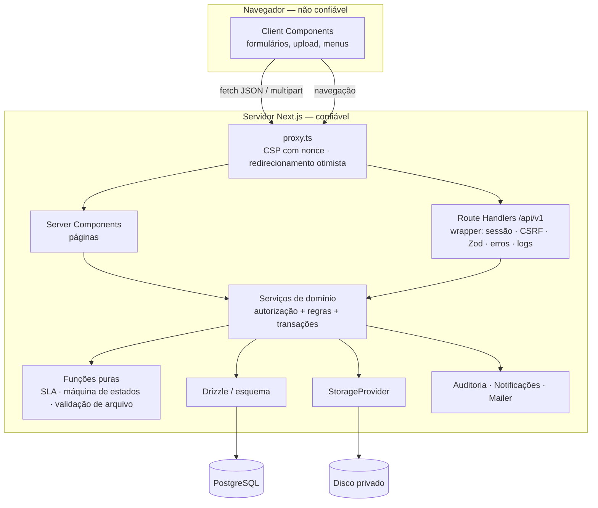
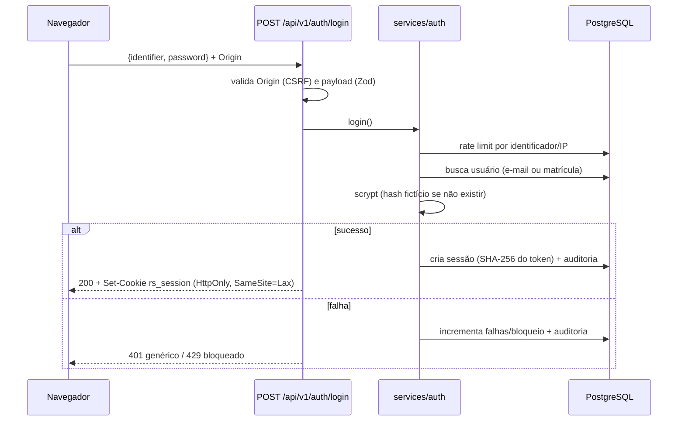

# Arquitetura

Monolito modular em Next.js 16 (ADR-0001), renderização dinâmica por requisição (ADR-0006), PostgreSQL via Drizzle (ADR-0002).

## Contexto

```mermaid
flowchart LR
  colab([Colaborador\nnavegador desktop/celular]) -->|HTTPS| app[Intranet REALSEG\nNext.js]
  rh([RH / Gestor — fase 2]) -.->|HTTPS| app
  app --> pg[(PostgreSQL 18)]
  app --> fs[(Armazenamento privado\nde arquivos)]
  app -->|SMTP| mail[[Provedor de e-mail\n— a definir]]
  cron[[Agendador\n(pnpm jobs:run)]] --> app
  app -.->|hook| av[[Antimalware\n— a definir]]
```

## Camadas e limites de confiança



- **Fronteira de confiança**: tudo que vem do navegador (IDs, filtros, arquivos, cabeçalhos) é validado no servidor. O `Actor` (usuário, papéis, permissões, vínculo organizacional) é sempre reconstruído a partir da sessão no banco.
- **Autorização** acontece nos serviços (`requirePermission` + escopo no SQL). Páginas e rotas não contêm regra de acesso própria além de exigir sessão.
- **Pastas**: `src/app` (rotas/páginas), `src/components` (UI reutilizável), `src/features/<módulo>` (componentes de cada módulo), `src/lib` (utilitários e schemas compartilhados cliente/servidor), `src/server` (env, db, auth, http, services, sla, tickets, files, audit, logger, mail), `scripts` (migração, seeds, jobs, servidor E2E), `tests` (unit/integration), `e2e` (Playwright).

## Fluxos principais

### Login e sessão


### Download de documento sensível
`GET /api/v1/documents/:id/file` → sessão válida → `openDocumentFile` consulta o documento **com o escopo do ator na cláusula WHERE** (pessoal do próprio vínculo ou institucional vigente) → auditoria `document.downloaded` (sem conteúdo) → stream do disco privado com `Cache-Control: private, no-store`, `nosniff`, `Content-Disposition`. Qualquer outro caso: 404.

### Abertura de solicitação com SLA
Transação única: categoria ativa → política vigente (área × prioridade) → calendário (cache 60 s) → vencimentos com `addBusinessMinutes` → insert do ticket (número por sequência) → evento `created` → anexos validados → remoção do rascunho → auditoria. Mudanças de status usam **controle otimista** (`version`) e registram eventos; pausas/retomadas recalculam o vencimento.

## Decisões e dependências
Ver `docs/ADR/0001`–`0011`. Dependências de runtime: next, react, drizzle-orm, pg, zod, lucide-react, date-fns + @date-fns/tz, clsx, tailwind-merge, nodemailer, @fontsource (fontes auto-hospedadas — CSP `font-src 'self'`). Desenvolvimento: embedded-postgres, drizzle-kit, vitest, @playwright/test, @axe-core/playwright, tsx, eslint.

## Observabilidade
- Logs estruturados JSON (`src/server/logger.ts`) com `requestId` (também devolvido em `x-request-id`), método, rota, status e duração; redação automática de campos sensíveis.
- Erros inesperados: log `http.unhandled_error` + resposta genérica com `requestId` para suporte.
- Métricas/APM: pendência (sugestão: OpenTelemetry via `instrumentation.ts`).
