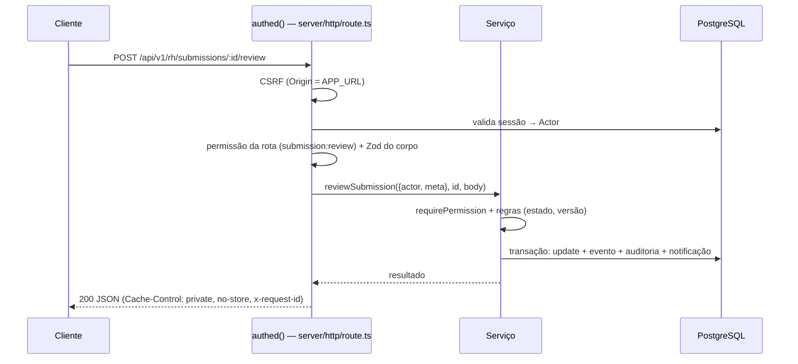

# Serviços de domínio

Os serviços em `src/server/services` concentram as **regras de negócio e a autorização**. Páginas (Server Components) e Route Handlers (`/api/v1`) não acessam o banco diretamente: chamam um serviço, que verifica permissão e escopo, executa a operação (em transação quando altera dados), registra auditoria e dispara notificações.

Veja também: [Arquitetura](visao-geral.md) · [API](api.md) · [Modelo de dados](../dados/modelo-de-dados.md) · [Segurança](../seguranca/seguranca.md)

## Contrato comum

```ts
// Toda função de serviço recebe o contexto da requisição, nunca dados de identidade vindos do cliente.
type Ctx = { actor: Actor; meta: RequestMeta };   // src/server/auth/actor.ts
```

- **`Actor`**: usuário, papéis, conjunto de permissões e vínculo de colaborador (`employee`: área, unidade, cargo, família). É reconstruído a partir da sessão no banco a cada requisição (`loadActor`).
- **`RequestMeta`**: `requestId`, `ipHash` (IP pseudonimizado com HMAC) e `userAgent`, usados na auditoria.
- **Autorização**: `requirePermission(actor, "recurso:ação")` + **escopo no SQL** (ex.: `owner_employee_id = actor.employee.id`). Recurso alheio ou inexistente gera `notFound()` → 404. Falta de permissão gera `forbidden()` → 403.
- **Erros**: `AppError` com código (`src/server/errors.ts`). O wrapper HTTP converte em JSON padronizado (ver [API › Convenções](api.md#convenções)).
- **Transações**: `getDb().transaction(...)`. Funções auxiliares aceitam `Executor` (conexão ou transação) para compor operações atômicas.
- **Concorrência**: entidades com edição concorrente (solicitações, envios de documento) usam a coluna `version` (controle otimista). Uma versão desatualizada responde `409 CONFLICT`.
- **Efeitos colaterais**: `audit()` (`src/server/audit.ts`) e `notify()` (`services/notifications.ts`) recebem o `Executor` da transação, para que auditoria e notificação sejam gravadas junto com a alteração (ou não sejam gravadas, se ela falhar).

### Fluxo de uma requisição



Nas páginas, o equivalente ao `authed()` é `requireCtx()` (colaborador) ou `requireRhCtx(permissão)` (gestão, `src/server/auth/rh.ts`). Sem acesso, a página responde "não encontrada".

## Serviços do colaborador (`src/server/services/*.ts`)

| Serviço | Responsabilidade | Principais funções | Permissões | Tabelas |
| --- | --- | --- | --- | --- |
| `auth.ts` | Login, logout, recuperação e troca de senha, bloqueio por tentativas | `login`, `logout`, `requestPasswordReset`, `resetPassword`, `changePassword` | pública (login/recuperação); sessão (troca) | `users`, `employees`, `password_reset_tokens`, `sessions`, `rate_limits` |
| `profile.ts` | Perfil, preferências (atalhos da Home, sidebar) e sessões ativas | `getProfile`, `getPreferences`, `updatePreferences`, `mySessions`, `revokeMySession` | `profile:read:own`, `profile:update:own` | `users`, `employees`, `user_preferences` |
| `notifications.ts` | Notificações in-app e preferências por categoria; `notify()` é usado por todos os módulos | `listNotifications`, `unreadCount`, `markRead`, `markAllRead`, `notify`, `setNotificationPreference` | `notification:read:own`, `profile:update:own` | `notifications`, `notification_preferences` |
| `home.ts` | Agrega a Home numa chamada (cada parte aplica a própria autorização) | `homeData` | herdadas | — |
| `announcements.ts` | Feed de comunicados por público-alvo, leitura, ciência, favoritos, anexos, agenda | `listAnnouncements`, `getAnnouncementPage`, `markAnnouncementRead`, `acknowledgeAnnouncement`, `setFavorite`, `upcomingEvents`, `getAnnouncementAttachment` | `announcement:read`, `announcement:acknowledge` | `announcements`, `announcement_*`, `events` |
| `audience.ts` | Regra SQL de público-alvo (`audienceMatch`), busca sem acento (`textSearch`) e `ref()` para subconsultas correlacionadas | `audienceMatch`, `textSearch`, `ref` | — (utilitário) | — |
| `documents.ts` | Documentos pessoais, normas, ciência, envios ao RH e histórico | `listMyDocuments`, `getDocument`, `openDocumentFile`, `acknowledgeDocument`, `listPolicies`, `createSubmission`, `cancelSubmission`, `documentHistory` | `document:read:own`, `document:acknowledge:own`, `document:submit:own`, `policy:read` | `documents`, `document_versions`, `document_acknowledgements`, `document_submissions`, `document_submission_events`, `file_assets` |
| `tickets.ts` | Solicitações com SLA, rascunhos, chat com o suporte, ações do atendente e monitor de SLA | `createTicket`, `listMyTickets`, `getMyTicket`, `addRequesterMessage`, `cancelMyTicket`, `confirmResolution`, `reopenMyTicket`, `startChat`, `saveDraft`, `agentReply`, `agentChangeStatus`, `agentAssign`, `agentChangePriority`, `runSlaMonitor` | `ticket:create`, `ticket:read:own`, `ticket:comment:own`; `ticket:manage` (funções `agent*`) | `tickets`, `ticket_*`, `sla_*` |
| `courses.ts` | Catálogo elegível, matrícula, progresso, certificados e trilhas | `listCourses`, `getCourse`, `enroll`, `getLesson`, `completeLesson`, `listMyCertificates`, `listLearningPaths`, `continueLearning` | `course:read`, `course:enroll` | `courses`, `course_*`, `lessons`, `enrollments`, `lesson_progress`, `certificates`, `learning_paths*`, `achievements` |
| `career.ts` | Visão de carreira, plano de cargos e faixas publicadas, oportunidades e candidaturas | `careerOverview`, `careerPlan`, `listOpportunities`, `applyToOpportunity`, `withdrawApplication`, `myGoals`, `myAchievements` | `career:read`, `opportunity:read`, `opportunity:apply` | `job_positions`, `salary_bands`, `internal_opportunities`, `opportunity_*`, `development_goals`, `achievements` |
| `feedbacks.ts` | Feedbacks publicados do próprio colaborador e confirmação de leitura | `listMyFeedbacks`, `getMyFeedback`, `acknowledgeFeedback` | `feedback:read:own`, `feedback:acknowledge:own` | `feedbacks` |
| `help.ts` | Central de ajuda: categorias, busca, sugestão de artigos, acessos e votos | `helpCategoriesWithCounts`, `searchArticles`, `suggestArticles`, `getArticle`, `registerArticleView`, `voteArticle` | `help:read` | `help_*` |
| `search.ts` | Busca global com o mesmo escopo de cada módulo | `globalSearch` | as de leitura de cada módulo | várias |

## Serviços de gestão (`src/server/services/rh/*.ts`)

Usados pelo ambiente `/rh` e pelas rotas `/api/v1/rh/*`. Toda função exige a permissão da ação. As listas aceitam abas e filtros vindos da URL.

| Serviço | Responsabilidade | Principais funções | Permissões |
| --- | --- | --- | --- |
| `dashboard.ts` | Painel da gestão. Cada bloco só é calculado para quem tem a permissão correspondente, e só com números agregados | `rhDashboard` | várias (por bloco) |
| `tickets.ts` | Fila de atendimento, detalhe para o atendente (com notas internas), atendentes disponíveis, resumo da fila. As **ações** (responder, situação, responsável, prioridade) ficam em `services/tickets.ts` | `listQueue`, `getTicketForAgent`, `listAgents`, `queueSummary`, `openTicketAttachmentAsAgent` | `ticket:read:any`, `ticket:manage` |
| `announcements.ts` | Editor de comunicados, público-alvo, anexos, publicação imediata ou agendada, versões, arquivo, duplicação e relatório de leitura/ciência | `createAnnouncement`, `updateAnnouncement`, `publishAnnouncement`, `publishDueAnnouncements` (cron), `archiveAnnouncement`, `restoreAnnouncement`, `deleteAnnouncement`, `duplicateAnnouncement`, `readingReport`, `readingReportCsv` | `announcement:manage`, `announcement:report`, `report:export` |
| `events.ts` | Agenda corporativa (unidade nula = todas), vínculo com comunicado | `listEventsAdmin`, `saveEvent`, `setEventStatus` | `announcement:manage` |
| `audience.ts` | Converte o público-alvo do formulário em regras (`toRules`/`fromRules`), valida referências e calcula destinatários | `toRules`, `fromRules`, `assertAudienceRefs`, `audienceUserIds`, `describeAudience` | — (utilitário) |
| `documents.ts` | Análise de envios, distribuição individual e em lote (casamento de arquivos por matrícula), normas e manuais, versões, arquivo e remoção auditada | `listSubmissionsAdmin`, `reviewSubmission`, `distributePersonalDocument`, `matchBatchFiles`, `createInstitutionalDocument`, `updateDocumentMeta`, `addDocumentVersion`, `setDocumentArchived`, `removeDocument` | `document:manage`, `document:read:any`, `submission:review` |
| `employees.ts` | Cadastro, primeiro acesso (senha temporária ou convite), situação, desbloqueio, papéis e importação CSV | `listEmployees`, `getEmployee`, `createEmployee`, `updateEmployee`, `setEmployeeStatus`, `resetEmployeeAccess`, `setEmployeeRoles`, `importEmployees` | `employee:read:any`, `employee:manage`, `role:manage` (papéis) |
| `employee-search.ts` | Busca rápida de colaboradores ativos para seletores | `searchEmployees`, `employeeBrief` | qualquer uma de `employee:read:any`, `document:manage`, `career:manage`, `feedback:write:any` |
| `org.ts` | Estrutura organizacional: áreas, unidades, famílias e cargos; opções para seletores | `orgOptions`, `structureOverview`, `saveDepartment`, `saveUnit`, `saveFamily`, `deleteFamily`, `savePosition` | `employee:manage` |
| `courses.ts` | Catálogo, módulos e aulas (ordenação), público, atribuição com prazo, participantes, trilhas e categorias | `createCourse`, `updateCourse`, `setCourseStatus`, `addModule`, `moveModule`, `addLesson`, `moveLesson`, `assignCourse`, `courseReport`, `courseReportCsv`, `savePath`, `saveCourseCategory` | `course:manage`, `course:report`, `report:export` |
| `career.ts` | Oportunidades internas e candidaturas, faixas salariais com visibilidade, planos de desenvolvimento | `saveOpportunity`, `setOpportunityStatus`, `setApplicationStatus`, `saveBand`, `deleteBand`, `saveGoal`, `deleteGoal` | `career:manage`, `salary_band:read:any` |
| `feedbacks.ts` | Registrar, editar (gera nova leitura), publicar e arquivar feedbacks | `createFeedback`, `updateFeedback`, `publishFeedback`, `archiveFeedback` | `feedback:write:any` |
| `help.ts` | Artigos (rascunho, publicado, arquivado) e categorias da central de ajuda | `saveArticle`, `setArticleStatus`, `saveHelpCategory` | `help:manage` |
| `media.ts` | Upload de imagens de capa (comunicados e cursos), servidas só a usuários autenticados e só enquanto estão em uso | `uploadCoverImage`, `openCoverImage`, `mediaUrl` | `announcement:manage` ou `course:manage` (envio) |
| `settings.ts` | Áreas de solicitação, matriz de prazos SLA (área × prioridade, versionada), expediente e feriados | `saveTicketCategory`, `slaMatrix`, `saveSlaPolicy`, `slaHistory`, `saveWorkingHours`, `addHoliday`, `deleteHoliday` | `sla:configure` |
| `audit-log.ts` | Consulta da trilha de auditoria com filtros e exportação CSV (a própria exportação é auditada) | `listAudit`, `auditCsv` | `audit:read` |

## Módulos de suporte (`src/server`)

| Módulo | Papel |
| --- | --- |
| `auth/session.ts` | Cria, valida e revoga sessões opacas. `last_seen_at` é atualizado no máximo a cada 5 minutos ([ADR-0003](adr/0003-sessoes-opacas.md)) |
| `auth/permissions.ts` | Catálogo de permissões, papéis padrão e `MANAGEMENT_PERMISSIONS` (fonte da verdade dos seeds) |
| `auth/actor.ts` · `auth/current.ts` · `auth/rh.ts` | `Actor`, `requirePermission`, `canManage`; `requireCtx` (páginas); `requireRhCtx` (páginas da gestão) |
| `auth/crypto.ts` | scrypt, tokens aleatórios, SHA-256, HMAC de IP |
| `http/route.ts` | Wrappers `authed` e `publicRoute`: sessão, CSRF, Zod, erros padronizados, log com `requestId` |
| `http/multipart.ts` | Leitura de `multipart/form-data` com limites de tamanho e de quantidade de arquivos |
| `sla/business-time.ts` · `sla/ticket-sla.ts` | Funções puras de minutos úteis e cálculo da situação do prazo ([ADR-0011](adr/0011-sla-minutos-uteis.md)) |
| `tickets/state-machine.ts` | Transições válidas de solicitação e quem pode executá-las ([Requisitos › RF-TKT](../produto/requisitos.md#rf-tkt--solicitações-e-sla)) |
| `files/storage.ts` · `files/validation.ts` | `StorageProvider` (disco local ou Cloudflare R2), validação por assinatura binária, hook antimalware ([ADR-0007](adr/0007-armazenamento-arquivos.md)) |
| `mail.ts` | `Mailer`: `outbox` (dev/teste) ou SMTP ([ADR-0008](adr/0008-email.md)) |
| `rate-limit.ts` | Janela fixa persistida no PostgreSQL (funciona com várias instâncias) |
| `audit.ts` · `logger.ts` | Auditoria sem conteúdo sensível; logs JSON com redação automática |
| `jobs/maintenance.ts` | Manutenção diária: monitor de SLA, publicação de comunicados agendados e limpeza ([Otimização de custos §7](../operacao/otimizacao-de-custos.md#7-jobs-uma-execução-por-dia)) |
| `env.ts` | Validação das variáveis de ambiente na inicialização ([Infraestrutura](../operacao/infraestrutura.md#variáveis-de-ambiente)) |

## Como adicionar uma funcionalidade

1. **Esquema**: altere `src/server/db/schema/*` e gere a migração ([Migrações](../dados/migracoes.md)).
2. **Permissão**: se for uma nova ação, inclua-a em `src/server/auth/permissions.ts` e no papel padrão. O seed de referência sincroniza o banco.
3. **Serviço**: escreva a regra em `src/server/services` (ou `services/rh` para a gestão), recebendo `Ctx`. Chame `requirePermission`, filtre o escopo no SQL, use transação, `audit()` e `notify()`.
4. **Validação**: schema Zod em `src/lib/validation` (compartilhado entre cliente e servidor).
5. **Rota**: `src/app/api/v1/.../route.ts` com `authed({ permission, body }, ...)`. Em `/api/v1/rh/*`, a permissão é verificada **antes** de ler o corpo ou o multipart. O teste `api-matrix` exige 403 para colaborador.
6. **Página**: Server Component que chama o serviço direto (sem HTTP interno), com `requireCtx`/`requireRhCtx`.
7. **Testes e docs**: teste de integração do serviço (inclusive autorização negativa), E2E da jornada, e atualização de [API](api.md), [Status](../produto/status-das-funcionalidades.md) e [Changelog](../../CHANGELOG.md).
