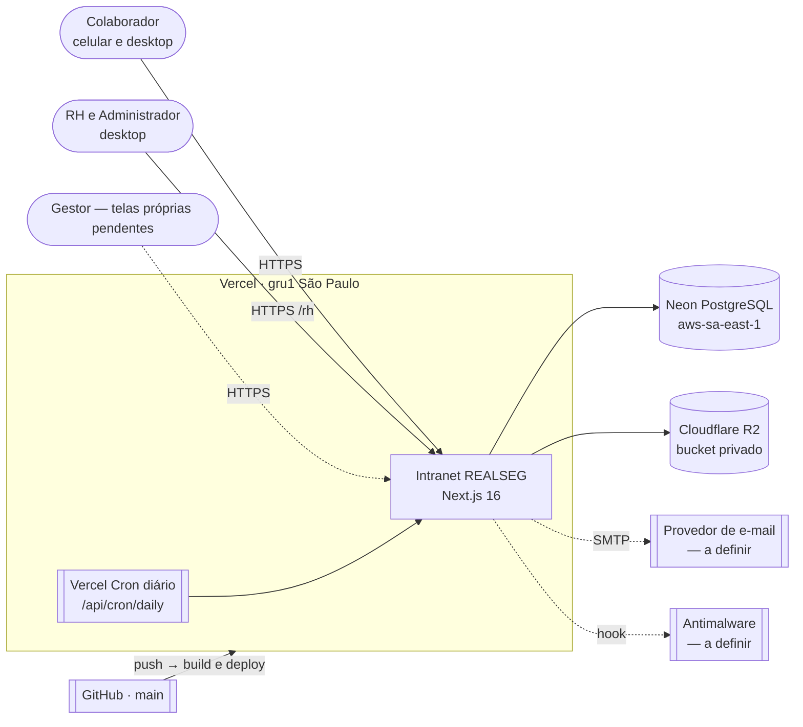
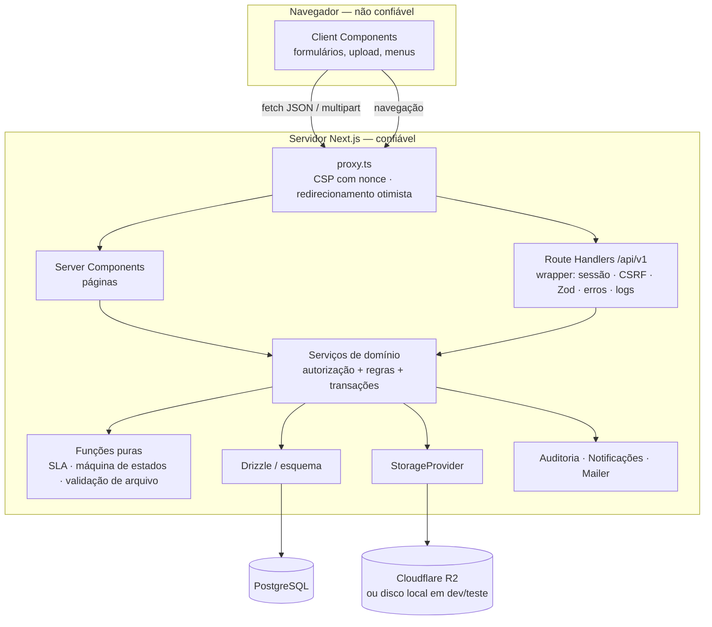
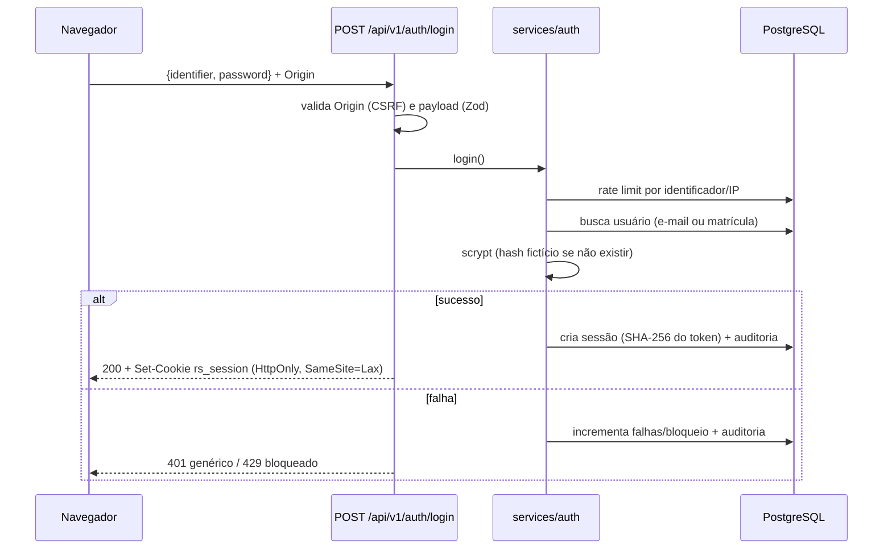

# Arquitetura

Monolito modular em Next.js 16 ([ADR-0001](adr/0001-stack-nextjs-fullstack.md)), renderização dinâmica por requisição ([ADR-0006](adr/0006-sem-cache-components.md)), PostgreSQL via Drizzle ([ADR-0002](adr/0002-postgresql-drizzle.md)). Um único deploy serve dois ambientes: o do **colaborador** (`/`) e o de **gestão** (`/rh`, RH e Administração).

Documentos relacionados: [Serviços de domínio](servicos.md) · [API](api.md) · [Modelo de dados](../dados/modelo-de-dados.md) · [Infraestrutura](../operacao/infraestrutura.md) · [Decisões (ADRs)](adr/README.md)

## Contexto



Linhas tracejadas indicam integrações previstas, ainda sem provedor definido. Detalhes de cada serviço externo em [Infraestrutura](../operacao/infraestrutura.md).

## Ambientes da aplicação

| Ambiente | Rotas | Quem acessa | Proteção |
| --- | --- | --- | --- |
| Autenticação | `(auth)`: `/login`, `/recuperar-senha`, `/redefinir-senha` | público | rate limit, CSRF, mensagens genéricas |
| Colaborador | `(colaborador)`: `/`, `/comunicados`, `/documentos`, … | todo usuário com vínculo de colaborador | `requireCtx()` + permissões `*:own` e escopo no SQL |
| Gestão | `(rh)`: `/rh/*` | quem tem alguma permissão de `MANAGEMENT_PERMISSIONS` (RH, Administrador) | `requireRhCtx(permissão da tela)`; sem acesso → "não encontrada" |
| API | `/api/v1/*` e `/api/v1/rh/*` | sessão válida | wrapper `authed()` com permissão por rota |
| Interno | `/api/cron/daily` | Vercel Cron | `Authorization: Bearer CRON_SECRET` |

O mapa completo de páginas está em [Mapa de telas](../produto/mapa-de-telas.md).

## Camadas e limites de confiança



- **Fronteira de confiança**: tudo que vem do navegador (IDs, filtros, arquivos, cabeçalhos) é validado no servidor. O `Actor` (usuário, papéis, permissões, vínculo organizacional) é sempre reconstruído a partir da sessão no banco.
- **Autorização** acontece nos serviços (`requirePermission` + escopo no SQL). Páginas e rotas só exigem sessão e, na gestão, a permissão da tela ou da rota; a regra de acesso a cada registro fica no serviço. Catálogo completo em [Serviços](servicos.md).

## Organização do código

```
src/app/
  (auth)/            login, recuperação e redefinição de senha
  (colaborador)/     telas do colaborador (layout com sidebar, topbar e barra inferior mobile)
  (rh)/rh/           ambiente de gestão (layout próprio, menu por permissão em components/layout/rh-nav.ts)
  api/v1/            Route Handlers REST do colaborador · api/v1/rh/ = gestão
  api/cron/daily/    manutenção diária
src/components/      ui/ (design system) · layout/ (sidebar, topbar, navegação) · admin/ (tabela, cabeçalho e indicadores da gestão)
src/features/        componentes de cada módulo: announcements, documents, tickets, courses, career, help, home, profile, auth, rh
src/lib/             utilitários e schemas Zod compartilhados entre cliente e servidor (validation/forms.ts, validation/rh.ts)
src/server/          env, db (esquema Drizzle), auth, http, services (+ services/rh), sla, tickets, files, jobs, audit, logger, mail
drizzle/             migrações SQL versionadas
scripts/             migrate, seeds (referência, demonstração, E2E), build da Vercel, servidor E2E, utilitários de dev
tests/ · e2e/        Vitest (unitários e integração) · Playwright (desktop e mobile, com axe)
```

## Fluxos principais

### Login e sessão


### Download de documento sensível
`GET /api/v1/documents/:id/file` → sessão válida → `openDocumentFile` consulta o documento **com o escopo do ator na cláusula WHERE** (pessoal do próprio vínculo ou institucional vigente) → auditoria `document.downloaded` (sem conteúdo) → stream do disco privado com `Cache-Control: private, no-store`, `nosniff`, `Content-Disposition`. Qualquer outro caso: 404.

### Abertura de solicitação com SLA
Transação única: categoria ativa → política vigente (área × prioridade) → calendário (cache 60 s) → vencimentos com `addBusinessMinutes` → insert do ticket (número por sequência) → evento `created` → anexos validados → remoção do rascunho → auditoria. Mudanças de status usam **controle otimista** (`version`) e registram eventos; pausas/retomadas recalculam o vencimento.

### Ação da gestão (ex.: publicar comunicado)
`POST /api/v1/rh/announcements/:id/publish` → `authed({ permission: "announcement:manage" })` → `publishAnnouncement` em transação: valida estado e público-alvo → `status = published` (ou `scheduled` com `publish_at`, auditado como `announcement.scheduled`) → auditoria `announcement.published` → notificação aos destinatários calculados por `audienceUserIds`. Agendados são liberados na hora marcada; o aviso sai na manutenção diária (`publishDueAnnouncements`) ou quando a gestão abre a lista.

## Decisões e dependências
Ver [índice de ADRs](adr/README.md). Dependências de runtime: next, react, drizzle-orm, pg, zod, lucide-react, date-fns + @date-fns/tz, clsx, tailwind-merge, nodemailer, aws4fetch (Cloudflare R2), @vercel/functions, @fontsource (fontes auto-hospedadas — CSP `font-src 'self'`). Desenvolvimento: embedded-postgres, drizzle-kit, vitest, @playwright/test, @axe-core/playwright, tsx, eslint.

## Observabilidade
- Logs estruturados JSON (`src/server/logger.ts`) com `requestId` (também devolvido em `x-request-id`), método, rota, status e duração; redação automática de campos sensíveis.
- Erros inesperados: log `http.unhandled_error` + resposta genérica com `requestId` para suporte.
- Métricas/APM: pendência (sugestão: OpenTelemetry via `instrumentation.ts`).
