# Modelo de dados

Estrutura do banco PostgreSQL: 63 tabelas em 9 domínios, com finalidade, chaves, acesso, retenção e dados pessoais de cada uma.

Fonte da verdade: `src/server/db/schema/*.ts`. Migrações versionadas em `drizzle/` — histórico e procedimento em [Migrações e seeds](migracoes.md). Relacionados: [Serviços](../arquitetura/servicos.md) (quem lê e grava cada tabela) · [Privacidade e LGPD](../seguranca/privacidade-lgpd.md) · [ADR-0002](../arquitetura/adr/0002-postgresql-drizzle.md).

Convenções: PK `uuid` (`gen_random_uuid()`), `timestamptz` em UTC, nomes em `snake_case`, FKs explícitas com política de exclusão documentada, enums PostgreSQL para estados.

## ERD (visão por domínio)

```mermaid
erDiagram
  users ||--o| employees : "vínculo"
  users ||--o{ user_roles : ""
  roles ||--o{ user_roles : ""
  roles ||--o{ role_permissions : ""
  permissions ||--o{ role_permissions : ""
  users ||--o{ sessions : ""
  users ||--o{ password_reset_tokens : ""
  departments ||--o{ employees : ""
  units ||--o{ employees : ""
  job_families ||--o{ job_positions : ""
  job_positions ||--o{ employees : ""
  job_positions ||--o{ salary_bands : ""
  announcement_categories ||--o{ announcements : ""
  announcements ||--o{ announcement_audiences : ""
  announcements ||--o{ announcement_reads : "por versão"
  announcements ||--o{ announcement_acknowledgements : "por versão"
  announcements ||--o{ announcement_favorites : ""
  announcements ||--o{ announcement_attachments : ""
  file_assets ||--o{ announcement_attachments : ""
  document_categories ||--o{ documents : ""
  employees ||--o{ documents : "destinatário (pessoal)"
  documents ||--o{ document_versions : ""
  file_assets ||--o{ document_versions : ""
  document_versions ||--o{ document_acknowledgements : ""
  employees ||--o{ document_submissions : ""
  document_submissions ||--o{ document_submission_events : ""
  ticket_categories ||--o{ tickets : ""
  ticket_categories ||--o{ sla_policies : ""
  sla_calendars ||--o{ sla_policies : ""
  sla_calendars ||--o{ sla_holidays : ""
  sla_policies ||--o{ tickets : "política congelada"
  employees ||--o{ tickets : "solicitante"
  tickets ||--o{ ticket_messages : ""
  tickets ||--o{ ticket_attachments : ""
  tickets ||--o{ ticket_events : ""
  tickets ||--o{ ticket_participants : ""
  employees ||--o{ ticket_drafts : ""
  course_categories ||--o{ courses : ""
  courses ||--o{ course_audiences : ""
  courses ||--o{ course_modules : ""
  course_modules ||--o{ lessons : ""
  courses ||--o{ enrollments : ""
  users ||--o{ enrollments : ""
  enrollments ||--o{ lesson_progress : ""
  enrollments ||--o| certificates : ""
  learning_paths ||--o{ learning_path_courses : ""
  employees ||--o{ development_goals : ""
  employees ||--o{ achievements : ""
  internal_opportunities ||--o{ opportunity_eligibility : ""
  internal_opportunities ||--o{ opportunity_applications : ""
  employees ||--o{ feedbacks : "destinatário"
  help_categories ||--o{ help_articles : ""
  help_articles ||--o{ help_article_feedback : ""
  users ||--o{ notifications : ""
  users ||--o{ audit_events : "ator"
```

## Dicionário de dados

Colunas `created_at`/`updated_at` existem em quase todas as tabelas e não são repetidas. **DP** = contém dado pessoal.

### Identidade e acesso
| Tabela | Finalidade | Campos principais | Chaves/índices | Acesso | Retenção | DP |
| --- | --- | --- | --- | --- | --- | --- |
| `users` | Conta de acesso | `email` (único, `lower()`), `password_hash` (scrypt), `status` (active/inactive), `failed_login_count`, `locked_until`, `must_change_password`, `last_login_at`, `deleted_at` | PK id; UQ `lower(email)` | Próprio usuário (perfil); RH (`employee:manage`) e ADMIN (papéis) em `/rh/colaboradores` | Desativar no desligamento; excluir/anonimizar conforme política legal | Sim |
| `roles`, `permissions`, `role_permissions` | RBAC configurável | `roles.key`, `permissions.key` | UQ key | Somente ADMIN (`role:manage`) | Permanente | Não |
| `user_roles` | Papéis do usuário com escopo opcional de setor | `scope_department_id`, `granted_by_user_id` | UQ (user, role, setor) NULLS NOT DISTINCT | ADMIN | Enquanto vigente | Não |
| `sessions` | Sessões opacas | `id` = SHA-256 do token, `expires_at`, `last_seen_at`, `revoked_at`, `user_agent` (200 chars), `ip_hash` | idx user, expires | Próprio usuário (lista/revoga) | Job remove 30 dias após expirar/revogar | Pseudonimizado |
| `password_reset_tokens` | Recuperação | `token_hash` (único), `expires_at` (30 min), `used_at` | UQ token_hash | Sistema | Job remove 7 dias após expirar | Não |
| `rate_limits` | Janelas de limite | `key` (identificador/IP hasheados), `count`, `reset_at` | PK key | Sistema | Limpeza diária | Pseudonimizado |
| `mail_outbox` | E-mails em dev/teste (ADR-0008) | `to`, `subject`, `text` | — | Somente dev/teste | Apagar livremente | Sim (dev) |

### Organização
| Tabela | Finalidade | Campos | Observações |
| --- | --- | --- | --- |
| `departments` | Setores (hierarquia opcional `parent_id`) | `code` UQ, `name` | Usado em público-alvo e escopo de gestor |
| `units` | Unidades/sites | `name` UQ, `city`, `state` | Eventos e oportunidades por unidade |
| `job_families` | Famílias profissionais | `name` UQ | Trilhas e plano de cargos |
| `job_positions` | Cargos/níveis | `family_id`, `level`, `level_label`, `requirements`, `progression_criteria` | idx (família, nível) |
| `employees` (DP) | Vínculo do colaborador | `user_id` UQ, `full_name`, `preferred_name`, `registration_number` UQ, `department_id`, `unit_id`, `job_position_id`, `manager_employee_id`, `admission_date`, `status` | Minimização: sem CPF, data de nascimento, endereço ou salário. Desligado → sem acesso ao ambiente do colaborador |

### Plataforma
| Tabela | Finalidade | Observações |
| --- | --- | --- |
| `file_assets` | Metadados de arquivos privados | `storage_key` aleatório (UQ), `original_name` sanitizado, `mime_type` detectado pelo conteúdo, `size_bytes`, `sha256`, `scan_status` (pending/clean/infected/skipped) |
| `audit_events` | Trilha de auditoria | `actor_user_id`, `action`, `entity_type`, `entity_id`, `metadata` (sem conteúdo sensível), `ip_hash`, `request_id`; idx (entidade), (ator, data), (ação, data). Retenção sugerida: 5 anos (validar com jurídico) |
| `notifications` (DP) | Notificações in-app | `category`, `title`, `body` (sem dados sensíveis), `link`, `read_at`; idx (user, created), (user, read_at) |
| `notification_preferences` | Preferências por categoria | PK (user, category); categoria `conta` é obrigatória |
| `user_preferences` | Atalhos da Home, sidebar recolhida | `home_shortcuts text[]` validado no servidor |

### Comunicação
| Tabela | Finalidade | Observações |
| --- | --- | --- |
| `announcement_categories` | Categorias (cor/ícone do design system) | |
| `announcements` | Comunicados | `status` draft/scheduled/published/archived, `publish_at`, `published_at`, `version` (incrementa em alteração relevante), `is_important`, `requires_ack`, `is_featured`, `author_label`; idx (status, published_at) |
| `announcement_audiences` | Público-alvo | `type` all/department/unit/job_position/job_family + `ref_id`; sem linha = ninguém (exige regra explícita) |
| `announcement_reads` (DP) | Visualização | PK (anúncio, usuário, versão) |
| `announcement_acknowledgements` (DP) | Ciência formal | PK (anúncio, usuário, versão) — leitura ≠ ciência |
| `announcement_favorites`, `announcement_attachments` | Favoritos; anexos | |
| `events` | Agenda | `unit_id` nulo = todas as unidades |

### Documentos
| Tabela | Finalidade | Observações |
| --- | --- | --- |
| `document_categories` | Tipos | `kind` personal/institutional/submission, `sensitive` (auditoria reforçada), `retention_months` (a definir pelo jurídico) |
| `documents` (DP quando pessoal) | Documento lógico | `scope` personal/institutional; CHECK: pessoal exige `owner_employee_id`; `current_version_id`; `requires_ack`; vigência; exclusão lógica `deleted_at`; idx (owner, created) |
| `document_versions` | Versões imutáveis | UQ (documento, número) |
| `document_acknowledgements` (DP) | Ciência por versão | UQ (versão, usuário) |
| `document_submissions` (DP) | Envios do colaborador | `number` (sequência, protocolo DOC-n), `status`, `review_note`, `version` (concorrência) |
| `document_submission_events` | Histórico de estados | |

### Solicitações e SLA
| Tabela | Finalidade | Observações |
| --- | --- | --- |
| `ticket_categories` | Áreas | `default_priority` |
| `sla_calendars` | Expediente | `timezone` IANA, `working_hours` JSON por dia da semana |
| `sla_holidays` | Feriados | UQ (calendário, data) |
| `sla_policies` | Prazos por área × prioridade | minutos úteis de 1ª resposta e resolução, `pause_statuses`, `warn_at_percent`; versão ativa única por (área, prioridade) via índice parcial `superseded_at IS NULL` — histórico preservado |
| `tickets` (DP) | Solicitações | `number` (sequência), `status`, `channel` (`portal` | `chat`, migration `0004_ticket_channel`), `priority`, `assignee_user_id`, `sla_policy_id`, vencimentos, `paused_at`, `paused_business_minutes`, marcas de violação/alerta, `version`; idx (solicitante, data), status, atendente |
| `ticket_messages` (DP) | Conversa | `is_internal` nunca exposto ao solicitante |
| `ticket_attachments`, `ticket_events`, `ticket_participants`, `ticket_drafts` | Anexos, histórico auditável (status, atribuição, prioridade, pausa/retomada, SLA), compartilhamento, rascunhos | |

### Aprendizagem
`course_categories`, `courses` (`is_mandatory`, `mandatory_due_days`, `issues_certificate`, `status`), `course_audiences`, `course_modules`, `lessons` (`type`, `content`, `video_url` restrito a provedores do CSP), `enrollments` (UQ curso×usuário; `progress_percent` cache recalculado na transação), `lesson_progress` (PK matrícula×aula — idempotência), `certificates` (UQ matrícula, `code` aleatório), `learning_paths`, `learning_path_courses`.

### Carreira e feedback
`salary_bands` (faixas por cargo, `visible_to_employees`, vigência), `development_goals`, `achievements` (UQ colaborador×código — conquistas automáticas idempotentes), `internal_opportunities` (`status`, `closes_at`, `is_highlighted`), `opportunity_eligibility` (sem linhas = todos), `opportunity_applications` (UQ vaga×colaborador; `retirada` permite nova candidatura), `feedbacks` (DP sensível: `status` rascunho/publicado/arquivado, `show_author`, `author_context`, `acknowledged_at`).

### Ajuda
`help_categories`, `help_articles` (`view_count` agregado e anônimo), `help_article_feedback` (PK artigo×usuário — evita voto duplicado; relatórios só agregados).

## Enums (estados)

| Enum | Valores | Usado em |
| --- | --- | --- |
| `user_status` | `active`, `inactive` | `users.status` |
| `employee_status` | `ativo`, `afastado`, `desligado` | `employees.status` (desligado bloqueia o acesso) |
| `audience_type` | `all`, `department`, `unit`, `job_position`, `job_family` | público-alvo de comunicados, cursos e oportunidades |
| `announcement_status` | `draft`, `scheduled`, `published`, `archived` | `announcements.status` |
| `event_status` | `scheduled`, `cancelled` | `events.status` |
| `document_category_kind` | `personal`, `institutional`, `submission` | `document_categories.kind` |
| `document_scope` | `personal`, `institutional` | `documents.scope` |
| `document_status` | `active`, `archived` | `documents.status` |
| `submission_status` | `enviado`, `em_analise`, `aceito`, `recusado`, `cancelado` | `document_submissions.status` |
| `file_scan_status` | `pending`, `clean`, `infected`, `skipped` | `file_assets.scan_status` |
| `ticket_status` | `aberto`, `em_andamento`, `aguardando_colaborador`, `respondido`, `resolvido`, `fechado`, `cancelado` | `tickets.status` ([transições](../produto/requisitos.md#rf-tkt--solicitações-e-sla)) |
| `ticket_priority` | `baixa`, `normal`, `alta`, `urgente` | `tickets.priority`, `sla_policies.priority` |
| `ticket_channel` | `portal`, `chat` | `tickets.channel` |
| `ticket_event_type` | `created`, `status_changed`, `assigned`, `priority_changed`, `sla_paused`, `sla_resumed`, `sla_warning`, `sla_breached`, `message_added` | `ticket_events.type` |
| `course_status` | `draft`, `published`, `archived` | `courses.status` |
| `lesson_type` | `texto`, `video`, `material` | `lessons.type` |
| `enrollment_source` | `self`, `assigned` | `enrollments.source` (matrícula própria ou atribuída pelo RH) |
| `enrollment_status` | `em_andamento`, `concluido` | `enrollments.status` |
| `development_goal_status` | `pendente`, `em_andamento`, `concluida` | `development_goals.status` |
| `achievement_kind` | `auto`, `manual` | `achievements.kind` |
| `opportunity_status` | `draft`, `published`, `closed` | `internal_opportunities.status` |
| `application_status` | `enviada`, `em_analise`, `encerrada`, `retirada` | `opportunity_applications.status` |
| `feedback_type` | `feedback`, `avaliacao`, `reconhecimento` | `feedbacks.type` |
| `feedback_status` | `rascunho`, `publicado`, `arquivado` | `feedbacks.status` |
| `help_article_type` | `artigo`, `tutorial`, `faq` | `help_articles.type` |
| `help_article_status` | `draft`, `published`, `archived` | `help_articles.status` |
| `notification_category` | `comunicados`, `documentos`, `solicitacoes`, `cursos`, `carreira`, `feedbacks`, `conta` | `notifications.category`, `notification_preferences.category` |

## Denormalizações justificadas
- `enrollments.progress_percent`: evita contagem em todas as listas; recalculado na mesma transação de `lesson_progress` (com `SELECT … FOR UPDATE`).
- `tickets.resolution_due_at`/`paused_business_minutes`: evitam recalcular histórico de pausas em listas; mantidos pelas transições.
- `help_articles.view_count`: contador anônimo (privacidade).

## Busca
Extensão `unaccent` + função `f_unaccent` (IMMUTABLE) para busca sem acento em comunicados, documentos, tickets, cursos e artigos. Todas as buscas aplicam o mesmo escopo de autorização das listas.

## Exclusão e retenção
- Documentos e usuários usam exclusão lógica; arquivos referenciados têm FK `restrict`.
- Prazos legais de retenção por categoria de documento ficam em `document_categories.retention_months` — **a definir com o jurídico/RH** (pendência em [Privacidade e LGPD](../seguranca/privacidade-lgpd.md#retenção-proposta--validar-com-jurídicorh)).

### Conteúdo estruturado do comunicado (migration 0003)
Campos opcionais em `announcements`, usados pela página de leitura (`referencias/Colado 2026-10-18 às 12.08.10.png`, ver [Referências visuais](../design/referencias-visuais.md)):
- `cover_image`: capa (caminho em `/images`; no futuro, chave do R2). Sem capa, a interface usa a cor/ícone da categoria.
- `effective_note`: texto do quadro "Quando começa a valer?".
- `highlights` (jsonb `[{icon, title, text}]`): seção "O que muda". Ícones aceitos: `shirt`, `badge`, `boot`, `shield`, `clock`, `calendar`, `alert`, `check`.
- `tags` (`text[]`, índice GIN): filtro `?tag=` na lista e base dos "Relacionados" (mais tags em comum → mesma categoria → mais recentes, sempre dentro do público do leitor).
- `support_ticket_category`: categoria de solicitação sugerida no quadro "Dúvidas?".
O texto (`body`) continua com a marcação simples (`## título`, listas, negrito).
