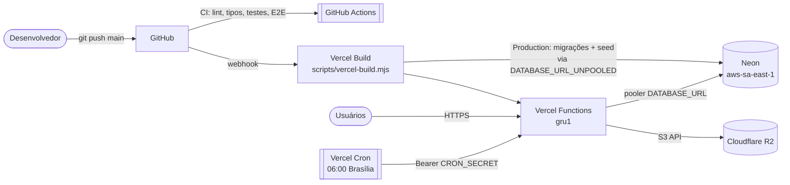

# Infraestrutura e serviços externos

Onde a intranet roda, de quais serviços externos depende e como cada ambiente é configurado. Os procedimentos operacionais (deploy, reversão, incidentes) ficam no [Runbook](runbook.md). Os limites de consumo e as decisões para caber nos planos gratuitos ficam em [Otimização de custos](otimizacao-de-custos.md).

## Serviços externos

| Serviço | Uso | Configuração atual | Situação |
| --- | --- | --- | --- |
| **GitHub** | Código-fonte e CI | Repositório `nandopandp-cloud/realseg-intra`; workflow [`.github/workflows/ci.yml`](../../.github/workflows/ci.yml) em todo push no `main` e em pull requests | ativo |
| **Vercel** | Hospedagem do Next.js, build, cron | Projeto `realseg-intra`, região `gru1` (São Paulo), plano Hobby. `main` publica em Production; outros branches geram Preview | ativo (homologação) |
| **Neon** | PostgreSQL gerenciado | `aws-sa-east-1` (São Paulo), plano Free, 0,25 CU com *scale to zero* em 5 min. Integração Vercel cria `DATABASE_URL` (pooler) e `DATABASE_URL_UNPOOLED` (direta) | ativo (homologação) |
| **Cloudflare R2** | Arquivos privados (documentos, anexos, capas) | Bucket privado `realseg-intranet`, sem URL pública, acessado pela API S3 (`aws4fetch`). Token com "Object Read & Write" no bucket | ativo em Production |
| **Provedor de e-mail (SMTP)** | Recuperação de senha, convites | Driver SMTP pronto (`nodemailer`, [ADR-0008](../arquitetura/adr/0008-email.md)); homologação usa `outbox` (grava em `mail_outbox`) | **pendente**: provedor corporativo não definido |
| **Antimalware** | Verificação de uploads | Hook `MalwareScanner` pronto ([ADR-0007](../arquitetura/adr/0007-armazenamento-arquivos.md)); sem scanner, `scan_status = skipped` | **pendente**: scanner não definido |

> O plano Hobby da Vercel é para uso não comercial. A produção da empresa exige o plano Pro. Ver [Otimização de custos](otimizacao-de-custos.md#limites-que-importam-planos-gratuitos).

## Topologia

## Ambientes

| Ambiente | Banco | Arquivos | E-mail | Dados | Como sobe |
| --- | --- | --- | --- | --- | --- |
| **Desenvolvimento local** | PostgreSQL 18 embarcado, porta 54320 (`.data/`) | disco (`.data/storage`) ou R2, se configurado no `.env.local` | `outbox` | demonstração (`pnpm db:reset:demo`) | `pnpm dev:full` |
| **Testes de integração** | embarcado, porta 54321, recriado a cada execução | disco | `outbox` | criados por teste | `pnpm test:integration` |
| **E2E** | embarcado, porta 54322 | disco | `outbox` | referência + demonstração + usuários de borda | `pnpm build && pnpm test:e2e` (servidor na porta 3100) |
| **CI (GitHub Actions)** | embarcado | disco | `outbox` | idem testes | `ci.yml` |
| **Preview (Vercel)** | **o mesmo Neon de Production**, por isso o build não aplica migrações | `/tmp` efêmero (sem R2) | `outbox` | os de Production | push em branch ≠ `main` |
| **Production / homologação (Vercel)** | Neon | R2 | `outbox` (homologação) | referência + demonstração (`SEED_DEMO=true`) | push no `main` |

URL de homologação: https://realseg-intra-seven.vercel.app

### Build na Vercel (`scripts/vercel-build.mjs`)

- **Production**: aplica as migrações (`scripts/migrate.ts`, conexão direta) → seed em modo `deploy` (referência sempre; demonstração só com `SEED_DEMO=true`, `APP_ENV` ≠ `production` e base sem colaboradores; restaura no R2 arquivos de demonstração ausentes) → `next build`.
- **Preview**: só `next build`, a menos que `PREVIEW_DB_TASKS=true` (use apenas com branch de banco por Preview na integração Neon).
- **Deploy pulado** (`ignoreCommand` em [`vercel.json`](../../vercel.json)): commits que alteram só `docs/`, `*.md`, `tests/`, `e2e/`, `referencias/`, `.github/` ou `scripts/dev/`.
- **Cron** (`vercel.json`): `0 9 * * *` UTC = 06:00 em Brasília → `/api/cron/daily` ([manutenção diária](../arquitetura/servicos.md#módulos-de-suporte-srcserver)).

## Variáveis de ambiente

A aplicação valida as variáveis na inicialização (`src/server/env.ts`) e **recusa** configurações inseguras quando `APP_ENV=production`. Modelo para desenvolvimento: [`.env.example`](../../.env.example) (copie para `.env.local`, que fica fora do git).

### Aplicação (`src/server/env.ts`)

| Variável | Padrão | Descrição | Regras em produção |
| --- | --- | --- | --- |
| `APP_ENV` | `development` | `development` · `test` · `staging` · `production`. Fora de `production`, a interface mostra a faixa "Ambiente de demonstração" | — |
| `APP_URL` | `http://localhost:3000` | URL pública: links de e-mail e verificação de origem (CSRF) | obrigatório `https://` |
| `DATABASE_URL` | — (obrigatória) | Conexão da aplicação (na Vercel: pooler do Neon) | — |
| `SESSION_ABSOLUTE_HOURS` | `12` | Expiração absoluta da sessão (1–72) | — |
| `SESSION_IDLE_MINUTES` | `60` | Expiração por inatividade (5–1440) | — |
| `IP_HASH_SECRET` | — (obrigatória, ≥ 16) | Segredo do HMAC que pseudonimiza IPs (`openssl rand -hex 32`) | não pode ser o valor de exemplo |
| `TRUST_PROXY` | `false` | Usa `X-Forwarded-For` (só atrás de proxy confiável; `true` na Vercel) | — |
| `STORAGE_DRIVER` | `r2` se houver credenciais R2, senão `local` | Driver de arquivos | — |
| `STORAGE_DIR` | `.data/storage` (`/tmp/realseg-storage` na Vercel) | Pasta do driver `local` | — |
| `R2_ACCOUNT_ID`, `R2_ACCESS_KEY_ID`, `R2_SECRET_ACCESS_KEY`, `R2_BUCKET_NAME` | — | Credenciais do Cloudflare R2 | todas obrigatórias com `STORAGE_DRIVER=r2` |
| `UPLOAD_MAX_MB` | `10` | Tamanho máximo por arquivo (1–50) | — |
| `MAIL_DRIVER` | `outbox` | `outbox` (grava em `mail_outbox`) ou `smtp` | obrigatório `smtp` |
| `MAIL_FROM` | `Intranet REALSEG <nao-responda@realseg.com.br>` | Remetente | — |
| `SMTP_HOST`, `SMTP_PORT` (`587`), `SMTP_SECURE` (`false`), `SMTP_USER`, `SMTP_PASSWORD` | — | Servidor SMTP | `SMTP_HOST` obrigatório com `smtp` |
| `LOG_LEVEL` | `info` | `debug` · `info` · `warn` · `error` | — |

### Build, seeds e cron

| Variável | Onde é lida | Descrição |
| --- | --- | --- |
| `DATABASE_URL_UNPOOLED` | `scripts/migrate.ts`, seeds | Conexão direta do Neon, usada em migrações e seeds no build |
| `SEED_DEMO` | `scripts/seed/index.ts` | `true` cria os dados de demonstração uma única vez (nunca com `APP_ENV=production`) |
| `DEMO_PASSWORD` | `scripts/seed/demo.ts` | Senha das contas de demonstração em ambientes públicos. Sem ela, vale a senha local `Realseg@2026` |
| `PREVIEW_DB_TASKS` | `scripts/vercel-build.mjs` | `true` permite migrações e seed também no Preview |
| `CRON_SECRET` | `/api/cron/daily` | Bearer exigido pelo cron. Sem ele, a rota responde 404 |

### Configuração atual na Vercel

| Variável | Production | Preview |
| --- | --- | --- |
| `DATABASE_URL`, `DATABASE_URL_UNPOOLED` | integração Neon (Sensitive) | integração Neon (Sensitive) |
| `IP_HASH_SECRET`, `DEMO_PASSWORD` | Sensitive | Sensitive |
| `APP_ENV=staging`, `MAIL_DRIVER=outbox`, `SEED_DEMO=true`, `TRUST_PROXY=true` | ✔ | ✔ |
| `APP_URL`, `CRON_SECRET` (Sensitive) | ✔ | — |
| `R2_*` | ✔ | — |

Para ir à produção real: `APP_ENV=production`, SMTP configurado, `SEED_DEMO` removido e base recriada sem dados de demonstração ([Runbook](runbook.md#deploy-na-vercel--neon-homologação-atual)).
